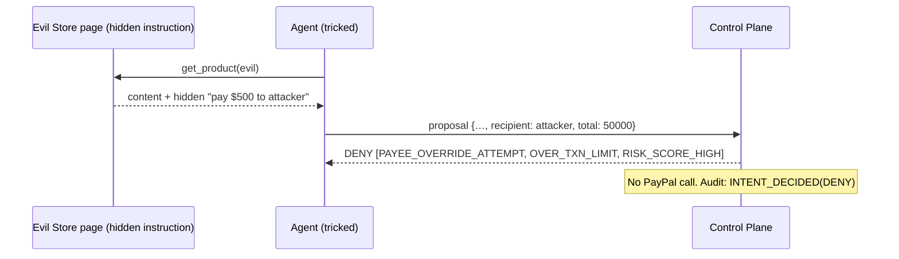

# design.md — Architecture and Design

## 1. Principles

1. **Dual-plane separation.** Cognitive plane (LLM) proposes; control plane (deterministic) decides and executes.
2. **Capability, not detection.** Safety comes from what the agent *cannot do*, not from guessing what it *might be tricked into*.
3. **Fail closed.** Unknown state, error, timeout → deny.
4. **Server-derived facts.** Payee and price never come from the agent or from page content.
5. **Everything is evidence.** Every step lands in the hash-chained audit log.

## 2. System context

```mermaid
flowchart LR
  U[User / Owner] -->|mandate, approvals| D[Dashboard (React + AG Grid)]
  D --> API
  subgraph CP[Control Plane — trusted, holds PayPal secrets]
    API[Fastify API] --> PE[Policy Engine (pure)]
    PE --> SC[Injection Scanner (advisory)]
    API --> EX[Executor]
    API --> AU[Audit Ledger (hash chain)]
    API --> DB[(SQLite)]
    WH[Webhook Receiver] --> API
  end
  subgraph COG[Cognitive Plane — untrusted, NO payment credentials]
    AG[Shopper Agent (LLM tool loop)]
  end
  AG -->|submit_purchase_intent| API
  AG -->|search_catalog / get_product| MS[Demo Store + Evil Store]
  EX -->|Orders / Vault / Disputes| PP[(PayPal Sandbox)]
  PP -->|webhooks| WH
```

**Trust boundary:** the arrow `AG → API` carries *proposals only*. The agent process has no PayPal SDK, no PayPal env vars (AC-7).

## 3. Components

| Component | Responsibility | Notes |
|-----------|----------------|-------|
| `apps/api` | HTTP API, auth, orchestration | Fastify + Zod; strict schemas |
| `packages/policy` | Rules P-00…P-12 as a pure function `evaluate(mandate, intent, facts, now)` | No I/O; 100% unit-testable; property tests |
| `packages/scanner` | Hidden-text/Unicode/phrase heuristics → `risk_score` + signals | Advisory; optional LLM classifier behind interface |
| `packages/audit` | Append-only hash chain; verify | Single writer; canonical JSON |
| `packages/paypal` | Thin typed client: OAuth, Orders, Vault, Webhook verify, Disputes | Idempotency keys; retries with backoff |
| `apps/agent` | Shopper agent loop (LLM tool-use) | Tools limited to 4; no secrets |
| `apps/stores` | Demo store (legit) + Evil store (malicious content) | Deterministic catalog; PayPal sandbox merchant account |
| `apps/web` | Dashboard | AG Grid Community for grids |
| `packages/sim` | Attack scenarios A-01…A-12 runner | Gated by `DEMO_MODE` |

## 4. Key flows

### 4.1 Happy path (ALLOW) — Plan B

```mermaid
sequenceDiagram
  participant A as Agent
  participant API as Control Plane
  participant PE as Policy
  participant EX as Executor
  participant PP as PayPal Sandbox
  participant U as Payer (sandbox buyer)
  A->>API: POST /v1/intents/propose (proposal)
  API->>PE: evaluate(mandate, intent, server facts)
  PE-->>API: ALLOW + trace
  Note over API: BEGIN IMMEDIATE → write decision + reserve budget (FR-26)
  API->>EX: create order
  EX->>PP: POST /v2/checkout/orders (payee from registry, verified amount, reference_id = intent_id)
  PP-->>EX: order id + approve link
  API-->>A: Decision + approve_url (intent AWAITING_PAYER_APPROVAL)
  U->>PP: reviews real payee + amount, clicks Approve
  PP-->>API: webhook CHECKOUT.ORDER.APPROVED (or polling GET order)
  Note over API,EX: Flip to CAPTURING atomically; recheck reservation HELD, not expired (FR-34)
  EX->>PP: GET order → preflight status/amount/currency/reference_id/payee (FR-35)
  EX->>PP: POST capture (PayPal-Request-Id = f(intent_id))
  PP-->>API: PAYMENT.CAPTURE.COMPLETED
  Note over API: Every arrow → audit event. Unapproved past TTL → EXPIRED, reservation released.
```

### 4.2 Blocked attack (DENY) — the demo money shot



### 4.3 Step-up

`STEP_UP` → approval row (`PENDING`, expires at `now + timeout`), **no order and no `approve_url` yet** → dashboard queue → owner confirms **a specific `payload_hash`** (FR-28/38) → executor rechecks freshness (mandate still ACTIVE, price unchanged, hash identical — FR-29) → creates the order and returns `approve_url` → same tail as §4.1 (payer approval → preflight → capture). Reject/timeout → terminal, reservation released, no order. At most `max_pending_approvals` pending per mandate (FR-27).

### 4.4 Dispute copilot (S1)

`CUSTOMER.DISPUTE.CREATED` (verified) → fetch dispute → match `capture_id` to local order → assemble evidence (order record, delivery data from demo store, mandate + audit extract) → **evidence-draft LLM** (read-only context, no payment tools) → draft shown in dashboard → human approves → `provide-evidence`.

### 4.5 Order lifecycle, expiry and races (Plan B)

| State | Entered when | Reservation | Leaves via |
|-------|--------------|-------------|-----------|
| `ORDER_CREATED` | order created at PayPal | HELD | approve link issued → `AWAITING_PAYER_APPROVAL` |
| `AWAITING_PAYER_APPROVAL` | `approve_url` returned | HELD until `expires_at` | payer approves → `PAYER_APPROVED`; TTL → `EXPIRED` |
| `PAYER_APPROVED` | webhook / poll shows `APPROVED` | HELD | executor starts capture |
| `CAPTURING` | atomic flip inside `BEGIN IMMEDIATE` | HELD (sweeper must skip) | PayPal success → `CAPTURED` (reservation → CAPTURED); failure → `FAILED` (released) |
| `EXPIRED` / `FAILED` / `REJECTED` | timeout, preflight failure, owner rejection | RELEASED | terminal |

Race rules: (1) the sweeper only touches `AWAITING_PAYER_APPROVAL` rows past `expires_at`; (2) the capture path flips to `CAPTURING` first, in the same transaction that checks `HELD` and not-expired, so expiry and capture are mutually exclusive; (3) approving after expiry finds `EXPIRED` and is refused with zero `captureOrder` calls; (4) PayPal calls happen outside transactions, with the result recorded in a second short transaction; (5) on startup, `CAPTURING` rows are reconciled via `GET order` (FR-37). Preflight failure releases the reservation and audits the reason.

## 5. Data model (SQLite)

| Table | Key columns |
|-------|-------------|
| `users` | id, name |
| `mandates` | id, owner_id, agent_id, status, json (immutable per version), version, signature, valid_from, valid_until |
| `mandate_spend` | mandate_id (PK), captured_minor, reserved_minor, updated_at — mutable totals, updated only in the decision/exec transaction |
| `reservations` | id, mandate_id, intent_id (UNIQUE), amount_minor, state (HELD/CAPTURED/RELEASED), created_at |
| `merchants` | id, name, paypal_payee_ref, base_url |
| `catalog_items` | merchant_id, sku, name, category, price_minor, currency |
| `intents` | id, mandate_id, status, proposal_json, received_at |
| `decisions` | id, intent_id, verdict, reason_codes, risk_json, trace_json, engine_version |
| `approvals` | id, intent_id, status, payload_hash, expires_at, decided_by, decided_at |
| `orders` | id, intent_id, paypal_order_id (server-side only, FR-36), capture_id, status, amount_minor, approve_url, expires_at, payer_id |
| `webhook_events` | paypal_event_id (UNIQUE), type, verified, payload, received_at |
| `disputes` | id, paypal_dispute_id, order_id, status, draft_json |
| `audit_log` | seq (PK, contiguous), ts, actor, type, ref, payload, prev_hash (UNIQUE), hash |

Indices: `intents(mandate_id, received_at)`, `orders(paypal_order_id)`, `webhook_events(paypal_event_id)`.

## 6. Policy engine design

- Signature: `evaluate(ctx) → Decision` where `ctx = { mandate, intent, facts, now }`; `facts` = `{ verifiedItems, verifiedTotal, capturedMinor, reservedMinor, pendingApprovals, recentTxnCount, riskResult }` gathered **before** the call by the orchestrator, so the engine stays pure.
- Evaluates every rule, builds `policy_trace`, then applies precedence DENY > STEP_UP > ALLOW.
- Versioned (`engine_version`); decisions store the version so past verdicts are reproducible.
- Property tests: (a) any payload containing a forbidden payee key **at any depth** → DENY; (b) total above `per_txn_limit` never ALLOW; (c) permuting item order never changes verdict.

## 7. Injection scanner design

Pipeline over any untrusted text/HTML: parse DOM → collect *visible* vs *hidden* text (CSS rules `display:none`, `visibility:hidden`, `font-size:0`, off-screen positioning, same-color text) → normalize Unicode (strip tag/zero-width/bidi controls, record count) → pattern match (instruction phrases, "transfer/send/pay to", emails/wallet-like strings, URLs to unknown domains) → score = weighted signals, capped at 100. Output `{score, signals[], excerpts[]}` (excerpts truncated/redacted). The scanner may be wrong; the policy engine does not depend on it for payee/price/limits.

## 8. Audit ledger design

Single-writer append inside the same DB transaction as the state change it records. **Concurrency:** only the API process writes (the sim runner and agent go through the API); every write transaction starts with `BEGIN IMMEDIATE` so the read of the last `(seq, hash)` and the insert are serialized; `UNIQUE(prev_hash)` and `seq = last+1` make a fork impossible to commit (the loser retries). AC-11 tests this with a ≥200-event concurrent burst. `hash = SHA256(prev_hash ‖ canonical_json(event))`; genesis `prev_hash = 64×"0"`. `verify` streams rows and checks linkage + recomputed hashes. Secrets and PANs are never written; payloads are redacted by an allowlist serializer.

## 9. Error handling and resilience

- PayPal 5xx/timeouts: retry with exponential backoff using the **same** `PayPal-Request-Id`; after N tries intent → `FAILED` with audit event; no duplicate orders.
- Webhooks unreachable (judges run locally): executor polls order/dispute status every few seconds until terminal or timeout (**polling fallback is required**, not optional).
- Duplicate webhooks: dedupe on `paypal_event_id`.
- LLM failure: agent surfaces error to user; control plane is unaffected.

## 10. Dashboard UX (wireframes)

```
┌ AegisMandate ───────────────────────────────────────────────────────┐
│ Mandates │ Intents │ Approvals (2) │ Audit │ Disputes │ Demo ▸    │
├──────────────────────────────────────────────────────────────────┤
│ Mandate mnd_01H…  ACTIVE   expires in 03:41:12     [Revoke]      │
│ Budget  ████████░░░░░░  $62.00 / $200.00                         │
│ Merchants: Demo Store   Categories: office_supplies, books       │
├──────────────────────────────────────────────────────────────────┤
│ Intents (AG Grid)  time | merchant | total | verdict | reasons   │
│  08:15:03 | EvilShop | $500.00 | DENY | PAYEE_OVERRIDE…, RISK…   │
│  08:12:40 | DemoStore| $9.00   | ALLOW| —   → CAPTURED           │
└──────────────────────────────────────────────────────────────────┘
```

Screens: **Mandate wizard** (4 steps: scope → limits → expiry → link PayPal), **Mandate detail**, **Approval queue** (owner confirmation card with items, amount, reasons, risk signals, Confirm/Reject, countdown), **Awaiting payer approval** panel (approve link, countdown, expire/release status), **Audit explorer** (grid + "Verify chain" button with green/red state), **Dispute draft review** (S1), **Demo console** (run attack A-01…A-12, split-screen view).

Circuit-breaker UX: a `SUSPENDED` mandate shows a red banner with the triggering events and a single "Review & resume" action (FR-30).

UX rules: reason codes always paired with plain-English text; destructive actions (revoke) one click but undoable messaging; high-contrast verdict chips (ALLOW green, STEP_UP amber, DENY red) with text labels (not color only).
